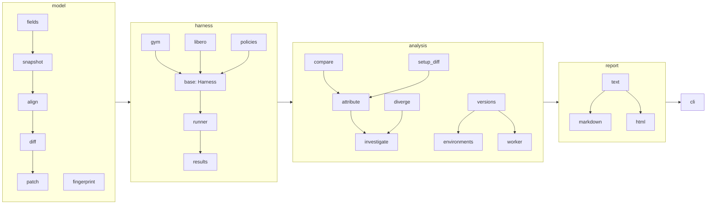

# Architecture

simblame is five small layers. Each layer only imports the layers above it in
this list, so you can read (and change) one without the others.

```
model     what a compiled MuJoCo model contains, how two differ, how to patch one
harness   how to build, reset, step and judge the user's two setups
analysis  the questions: is it real? which change? where? which release?
report    turning results into terminal text, Markdown and HTML
cli       argument parsing; every command is a thin wrapper over analysis + report
```

Three dependency-free utility modules sit beside the layers and may be used by any of
them: `stats.py` (paired statistics), `seeds.py` (seed specifications) and
`progress.py` (progress bars on stderr).



## Data flow of `simblame run`

1. **harness** builds both environments; `Runner` runs seeded episodes and
   hashes every rollout (`Episode.traj_hash`).
2. **analysis.compare** pairs the outcomes per seed → `Comparison`
   (McNemar test, CIs, bit-identical count, `Verdict`).
3. **analysis.setup_diff** snapshots both compiled models after reset
   (`model.snapshot`), ignores fields that change between resets, and diffs
   them (`model.diff` → `ModelDiff` of `Change`s).
4. **analysis.attribute** groups the changes (category → entity → field),
   and for each group re-runs the flipped seeds as *A + group* (does it
   reproduce the flips?) and *B − group* (does reverting it rescue them?) by
   writing values into the live models (`model.patch.Patch`), then scores each
   group's share and role. Roles above "minor" require a significant effect.
5. **analysis.diverge** records one flipped seed in both setups (`Trajectory`)
   and finds the first step / bodies / contacts that differ.
6. **analysis.investigate** orchestrates 1–5 into an `Investigation`;
   **report.text / markdown / html** render it; the CLI writes the files.

`simblame versions` reuses steps 1, 3 and 5 across MuJoCo releases:
`analysis.environments` builds one cached virtualenv per release (a clone of
the current environment with only `mujoco` changed), `analysis.worker` runs the
harness there and writes portable results (`ModelSnapshot.save`,
`Trajectory.save`), and `analysis.versions` compares them.

## Design rules

* **Data and words are separate.** Analysis objects hold numbers and expose
  `to_dict()`; every sentence a user reads is produced in `report/text.py`.
  `str(obj)` on any result calls the matching renderer. This is the one
  sanctioned upward import: `__str__` (and `Investigation.next_steps`) import
  `report.text` lazily, inside the method, so the layers stay acyclic at import time.
* **No guessing about MuJoCo's field list.** `model/fields.py` classifies fields
  by prefix/suffix rules, so new MuJoCo releases work without code changes;
  exceptions are explicit tables with comments.
* **Patches must be exact or say they aren't.** Anything that can't be written
  in place (topology, mesh sizes, compiler flags) is reported as not
  patchable and marked `(!)` in attribution, never silently dropped.
* **Paired and deterministic first, more samples second.** Every comparison
  uses the same seeds on both sides; determinism is checked before trusting it.
* **Core dependencies: `mujoco` and `numpy` only.** Adapters import their
  frameworks (gymnasium, LIBERO, stable-baselines3) lazily.

## Where to add things

| You want to… | Touch |
|---|---|
| support a new benchmark without user code | `harness/<name>.py` (subclass `Harness`) + a flag in `cli/targets.py` |
| load a new kind of policy | `harness/policies.py` |
| fix a field that is classified wrongly | `model/fields.py` + a test in `tests/model/test_diff.py` |
| change how results are worded | `report/text.py` |
| add a chart to the HTML report | `report/html.py` |
| add an analysis | new module in `analysis/`, export it in `analysis/__init__.py`, render it in `report/text.py`, expose it in `cli/main.py` |
