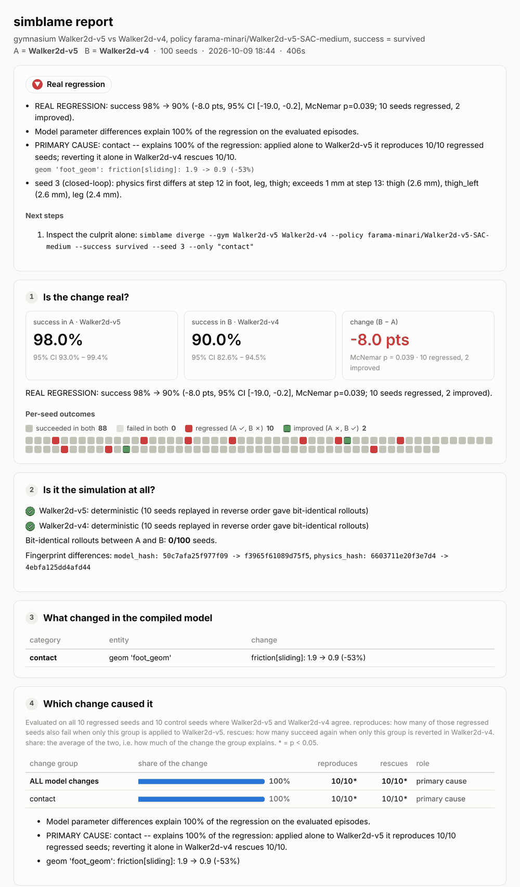

# simblame

[中文说明](docs/zh-CN.md)

**`git blame` for simulated physics.** Your robot policy scored 98% yesterday and 90% today.
simblame tells you whether the drop is real, whether it comes from the simulation at all,
**which physics change caused it**, and where in the rollout the physics first diverged.

```bash
pip install -e ".[gym]"     # from a clone of this repo
simblame run --gym Walker2d-v5 Walker2d-v4 \
    --policy farama-minari/Walker2d-v5-SAC-medium --success survived --seeds 100
```

```text
== Verdict ==========================================================
REAL REGRESSION: success 98% -> 90% (-8.0 pts, 95% CI [-19.0, -0.2], McNemar p=0.039;
10 seeds regressed, 2 improved).
Model parameter differences explain 100% of the regression on the evaluated episodes.
PRIMARY CAUSE: contact -- explains 100% of the regression: applied alone to Walker2d-v5 it
reproduces 10/10 regressed seeds; reverting it alone in Walker2d-v4 rescues 10/10.
    geom 'foot_geom': friction[sliding]: 1.9 -> 0.9 (-53%)
seed 3 (closed-loop): physics first differs at step 12 in foot, leg, thigh; ...

Next steps
  1. Inspect the culprit alone: simblame diverge --gym Walker2d-v5 Walker2d-v4 ... --seed 3 --only "contact"

Report: simblame-report/report.html  (also report.md, report.json)
```

That is a real result: Gymnasium's only physics change between `Walker2d-v4` and `-v5` is
the right foot's friction (0.9 → 1.9). simblame found it from 100 rollouts of a public
policy, with no code and no hint.



## Validated on real benchmarks

Blind runs on public benchmarks whose answer is known. Full commands and outputs:
[`docs/validation.md`](docs/validation.md).

| Case | Known answer | simblame says | |
|---|---|---|---|
| **LIBERO** `libero_spatial/5`, 50 official init states, MuJoCo 3.2.7 … 3.8.1 | MuJoCo ≥ 3.4.0 leaves the bowl tilted on the ramekin after reset ([lerobot#4390](https://github.com/huggingface/lerobot/issues/4390)) | first changing release **3.3.7 → 3.4.0** (100% → 0%, p=1.8e-15); compiled model identical, so the engine changed; the **bowl** moves 4.1 cm | ✅ |
| **Walker2d v5 vs v4**, Minari SAC *medium*, 100 seeds | only physics change: foot friction 0.9 → 1.9 | 98% → 90% (p=0.039); **primary cause `foot_geom` friction**, 100% | ✅ |
| **Walker2d v5 vs v4**, Minari SAC *expert*, 100 seeds | same | 100% → 72% (p=7.5e-9); **primary cause `foot_geom` friction**, 100% | ✅ |
| **Walker2d v5 vs v4**, older *medium* checkpoint, 100 seeds | same | 99% → 30% (p=6.1e-20); **primary cause `foot_geom` friction**, 100% | ✅ |
| **Hopper v5 vs v4** (null control), 100 seeds | no physics change | **IDENTICAL**: 100/100 bit-identical rollouts, empty model diff | ✅ |
| **HalfCheetah v5 vs v4** (null control), 100 seeds | no physics change | **IDENTICAL**: 100/100 bit-identical rollouts, empty model diff | ✅ |
| **Meta-World** pick-place, 5 asset edits injected at once | the gripper gain edit (kp 400 → 60) | 100% → 22%; **main cause: actuators** (gripper gains); pad friction, mass, solver flagged weak / minor | ✅ |

## Install

```bash
git clone https://github.com/isospin01/simblame && cd simblame
pip install -e .                   # core: mujoco + numpy
pip install -e ".[gym]"            # + gymnasium, stable-baselines3, huggingface_hub
pip install -e ".[libero]"         # + LIBERO
pip install -e ".[metaworld]"      # + Meta-World examples
```

Python ≥ 3.10, MuJoCo ≥ 2.3.3 (tested on 3.2.7 – 3.15.0). Try it in two seconds with no extra
dependencies: `simblame run examples/toy_push/harness.py`.

## Use it

**1. Built-in benchmarks, no code.** Compare two gymnasium environments (or the same id with
different `gym.make` kwargs), or a LIBERO task across MuJoCo releases:

```bash
simblame run --gym Hopper-v5 --a-kwargs xml_file=hopper_old.xml --b-kwargs xml_file=hopper_new.xml \
    --policy my_policy.zip --success survived
simblame versions --libero libero_spatial/5 --mujoco 3.3.0..3.8.1
```

`--policy` takes `zero`, `random`, a stable-baselines3 `.zip`, a HuggingFace repo
(`org/repo` or `org/repo/file.zip`), or `file.py:factory`. `--success` is `info`
(the env's `info["success"]`), `survived`, or `return>=X`.

**2. Your own setup: a harness file.** `simblame init` writes a commented template; the
essential part is about ten lines:

```python
# my_harness.py
import simblame as sb

class MyEval(sb.Harness):
    variants = ("main", "new-assets")   # setup A (baseline), setup B (candidate)
    max_steps = 500

    def make_env(self, variant):
        xml = "robot.xml" if variant == "main" else "robot_new.xml"
        return MyEnv(xml)               # anything with reset(seed=...) / step(action)

    def make_policy(self, variant):
        return load_my_policy("ckpt.pt")  # anything with get_action/act/predict, or a callable
```

```bash
simblame run my_harness.py --seeds 100
```

simblame finds the `MjModel` behind common wrappers (gymnasium, Meta-World, robosuite,
dm_control) on its own; override `get_model` / `get_data` otherwise. The one requirement is
that `reset(seed)` fully determines the episode; `simblame check` verifies it.

**3. Python.**

```python
import simblame as sb
from simblame.harness.gym import GymHarness

inv = sb.investigate(GymHarness("Walker2d-v5", "Walker2d-v4",
                                policy="farama-minari/Walker2d-v5-SAC-medium",
                                success="survived"), seeds=range(100))
print(inv)                                   # the verdict, as printed by the CLI
inv.comparison.verdict                       # 'regression'
inv.attribution.main_cause().name            # 'contact' (attribution is None if not significant)
inv.to_dict()                                # everything, JSON-ready
```

## What it answers

`simblame run` does all of it and writes `report.html`, `report.md` and `report.json`.
Each step is also its own command:

| Question | Command | How |
|---|---|---|
| Are episodes reproducible? | `check` | replays seeds in a different order and compares rollouts bit for bit |
| Is the change real? | `compare` | same seeds for both setups; exact McNemar test on the seeds that flipped; `--cross` runs the policy × environment 2×2 |
| What changed in the physics? | `diff` | diffs the **compiled** `mjModel` (sees default classes, includes, mesh-derived inertia, compiler changes), grouped by category and named entity |
| Which change caused it? | `attribute` | writes each group of changes into the live model (no rebuild): applied alone to A, does it reproduce the flips? reverted alone in B, does it rescue them? Drills from category to entity |
| Where does it start? | `diverge` | first step, bodies and contacts that differ; `--open-loop` replays A's actions to separate physics from the policy's reaction |
| Which MuJoCo release? | `versions` | runs your setup on each release in cached virtualenvs (a copy of your environment with only `mujoco` changed); sweep or `--bisect` |

## How it works

1. **Snapshot** every array of the compiled `mjModel` plus `mjOption`, with entity names,
   saved portably so models from *different MuJoCo versions* can be compared.
2. **Classify** ~400 fields by meaning (`param` / `derived` / `structural` / `rendering`)
   and by category (contact, inertia, geometry, joints, actuators, solver & options, …).
   Changes below 1e-6 relative are reported separately as float-level noise.
3. **Patch**: write B's values into A's live model (or the reverse), then `mj_setConst`
   recomputes dependent constants. No XML regeneration, no environment rebuild.
4. **Attribute** on the flipped seeds plus unchanged controls. *Reproduces* (A + g) measures
   sufficiency, *rescues* (B − g) necessity; *share* is their average as a fraction of the
   whole A→B change. Roles: primary cause, main cause amplified by others, only harmful
   together, sufficient but redundant, contributing, minor, not involved. If no single group
   explains the change, groups are combined greedily until they do.
5. **Diverge**: record body positions and contacts per step; report the first step that
   differs at all, the first that exceeds 1 mm, the bodies that end up furthest apart, and
   contacts present in only one rollout.

Code map and design rules: [`ARCHITECTURE.md`](ARCHITECTURE.md). Why this tool exists and
how it compares to existing ones: [`docs/problem.md`](docs/problem.md).

## Limitations

- MuJoCo on CPU only. MJX, MuJoCo Warp and Isaac Lab/Newton are on the [roadmap](ROADMAP.md).
- Attribution covers compiled-model **parameters**. Topology changes (added or removed
  bodies, retargeted actuators, re-meshed assets with a new vertex count, changes that flip
  a body's diagonal-mass-matrix flag) are reported and marked `(!)` but can't be patched in
  place. Engine changes (a new MuJoCo release with an identical compiled model, as in the
  LIBERO case) are found by `versions`, not by `attribute`.
- Code, observation-pipeline and reward changes show up as "the model differences explain
  only X%", or as *not the physics* when rollouts are bit-identical but scores differ.
- Patches act on the live `MjModel`. State that an environment copies into Python when it is
  built (gymnasium's `init_qpos` from `qpos0`, keyframes) is not patched, so changes to
  initial poses are under-attributed.
- Rendering (cameras, lights, textures, colours) is hidden by default. For vision-based
  policies pass `--all`.
- Environments that rebuild their `MjModel` inside `reset()` (robosuite's default
  `hard_reset`) get a warning: anything simulated during reset uses unpatched physics. The
  LIBERO adapter turns `hard_reset` off.
- Shares are first-order estimates on the evaluated seeds; interactions are flagged and
  combined greedily, not fully decomposed.
- `versions` needs [`uv`](https://docs.astral.sh/uv/) and network access the first time.
  Results are exact for one machine and build; other platforms may differ at float level.

## Project

[ARCHITECTURE.md](ARCHITECTURE.md) · [CONTRIBUTING.md](CONTRIBUTING.md) ·
[docs/validation.md](docs/validation.md) · [ROADMAP.md](ROADMAP.md) ·
[CHANGELOG.md](CHANGELOG.md) · Apache-2.0
